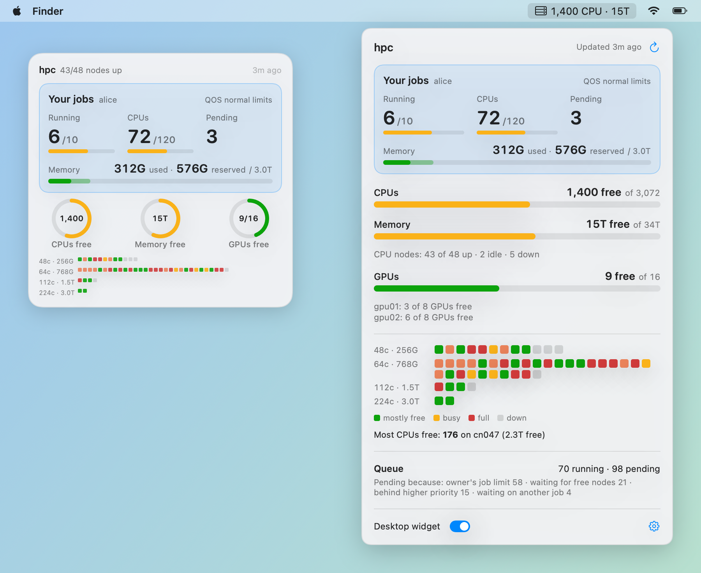

# SLURM Meter

A tiny native macOS menu bar app + desktop widget that shows how busy your **SLURM cluster** is — free CPUs, memory and GPUs, which nodes are full or down, and your own jobs against your limits.

<picture>
  <source media="(prefers-color-scheme: dark)" srcset="docs/showcase-dark.png">
  
</picture>

<sub>Screenshots use a made-up demo cluster.</sub>

## Features

- **Your jobs, front and center** — running jobs, CPUs and pending jobs in large type, with bars against your QOS per-user limits. Memory shows both what your running jobs actually **use** (sum of each job's peak so far, from `sstat`) and what they **reserve**, on one bar up to your limit.
- **Menu bar** — free CPUs and memory at a glance: `1,400 CPU · 15T`.
- **Free resources** — CPUs, memory and GPUs that SLURM can still allocate on nodes accepting jobs. Memory is `RealMemory − AllocMem` (what the scheduler sees), not the OS's free memory.
- **Node map** — one square per node, one row per node type (`64c · 768G`). Color shows how allocated the node is (CPU or memory, whichever is higher): green < 50%, yellow < 75%, orange < 90%, red ≥ 90%, gray = down. Hover for details.
- **Queue** — running / pending jobs and why jobs are pending.
- **Desktop widget** — sits on the desktop behind your windows; right-click for always-on-top, settings, hide, or quit. Drag to move. Double-click the app to bring a hidden widget back.
- Refreshes every 10 minutes (5 / 10 / 30 in the gear menu), on wake, and when you open the popover if the data is over 2 minutes old. Keeps showing the last data if the cluster can't be reached.

## Requirements

- macOS 14 (Sonoma) or later
- Key-based SSH access to a SLURM login node that works without a password prompt (`ssh -o BatchMode=yes <host> true` should succeed)
- Xcode Command Line Tools (`xcode-select --install`) to build

## Install

```bash
git clone https://github.com/wshuai294/slurm-meter.git
cd slurm-meter
./build.sh --install            # builds and installs to ~/Applications/"SLURM Meter.app", then launches it
./build.sh --install ~/Desktop  # or put the app somewhere else
```

On first launch, click the menu bar icon → **Cluster settings…** and enter:

- **SSH host** — anything `ssh` accepts: `user@login.cluster.edu` or a `Host` alias from `~/.ssh/config`.
- **Hide partitions** (optional) — comma-separated partitions to leave out, e.g. a login or debug partition.

Settings are stored only in this Mac's preferences.

## How it works

Each refresh is a single `ssh -o BatchMode=yes <host>` call running read-only commands:

| Command | Used for |
|---|---|
| `scontrol show node -o` | per-node CPUs, memory, GPUs (`gres/gpu`), state |
| `squeue -r -O …` | running / pending jobs, reasons, your jobs |
| `sacctmgr show assoc / show qos` | your default QOS and its per-user limits |
| `sstat -j <your running jobs>` | actual memory used by your jobs (MaxRSS) |

Nodes with GPUs are shown in the GPU section; partitions made up only of GPU nodes don't count toward the CPU queue. The last output is cached in `~/Library/Application Support/SlurmMeter/last.txt` so a restart shows numbers immediately. Nothing is sent anywhere else and nothing is submitted or changed on the cluster.

## Development

```bash
./build.sh                                                            # build/SlurmMeter.app
build/SlurmMeter.app/Contents/MacOS/SlurmMeter --snapshot out --demo  # render screenshots with the demo cluster
```

`--snapshot <dir>` without `--demo` renders your real data. `SLURM_METER_HOST=<host>` overrides the configured host.

| File | |
|---|---|
| `Sources/Cluster.swift` | SSH call, parsing of `scontrol` / `squeue` / `sacctmgr` / `sstat`, derived numbers |
| `Sources/ClusterStore.swift` | refresh timer, settings, app state |
| `Sources/YourJobs.swift`, `PopoverView.swift`, `Widget.swift`, `NodeMap.swift`, `Support.swift` | UI |
| `Sources/Snapshot.swift` | screenshot / demo mode |

## License

[MIT](LICENSE)
